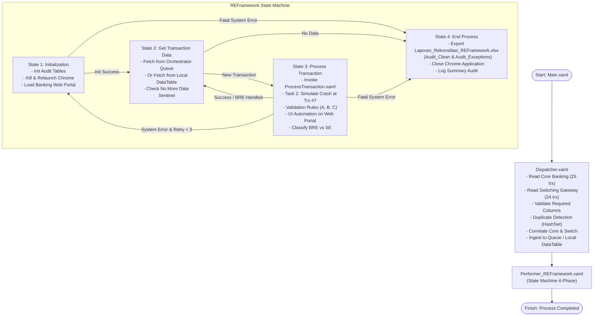

# Implementation Report: Day 30 Banking Reconciliation Enterprise REFramework

## 1. Executive Summary
Projek automasi **Day30_BankingReconciliation** telah berhasil dikembangkan, distrukturisasi, divalidasi, dan diuji sesuai dengan seluruh spesifikasi praktikum dan tugas homework Juara Coding Bootcamp Day 30.

Projek ini mengimplementasikan paradigma otomasi enterprise modern UiPath (Windows C#):
- **Arsitektur Master Launcher (`Main.xaml`)**: Mengorkestrasi Dispatcher dan Performer secara modular.
- **Dispatcher Sequence (`Workflows\Dispatcher.xaml`)**: Membaca data multi-sumber, memvalidasi skema kolom, mendeteksi duplikasi, mengkorelasikan data transaksi, dan melakukan ingestion ke UiPath Orchestrator Queue secara andal dengan offline caching fallback.
- **Performer REFramework State Machine (`Workflows\Performer_REFramework.xaml`)**: State Machine murni 4 fase (`Initialization`, `Get Transaction Data`, `Process Transaction`, `End Process`) dengan pemisahan tegas antara BusinessRuleException (BRE) dan SystemException (SE).
- **Process Transaction Business Logic (`Workflows\ProcessTransaction.xaml`)**: Melakukan rekonsiliasi tiga arah (Core Banking vs Switching Gateway vs Banking Monitoring Web Portal), validasi format nomor rekening, validasi nominal, serta mekanisme simulasi Chrome Crash pada transaksi ke-7 dengan auto-retry.
- **Penyempurnaan Laporan Excel 2 Sheet (`Data\Output\Laporan_Rekonsiliasi_REFramework.xlsx`)**: Menghasilkan 10 kolom standar perbankan dengan pemisahan sheet `Audit_Clean` (17 transaksi matched) dan `Audit_Exceptions` (8 transaksi exception).

Seluruh workflow XAML dan konfigurasi C# telah divalidasi menggunakan CLI `uip rpa validate` dengan **0 error** dan dicompile menggunakan `uip rpa build` dengan **Success: true**.

---

## 2. Arsitektur Final & Diagram Alur

---

## 3. Komponen Workflow & Penjelasan Fungsi

### A. `Main.xaml` (Master Launcher)
- **Tipe**: Sequence
- **Fungsi**: Berperan sebagai orchestrator utama proses.
- **Alur Kerja**:
  1. Melakukan logging inisiasi enterprise pipeline.
  2. Memanggil `Workflows\Dispatcher.xaml` untuk menyiapkan data transaksi dari spreadsheet Core Banking dan Switching Gateway.
  3. Memvalidasi bahwa ingestion selesai dan menerima output parameter (`dtTransactionData`, `totalCore`, `totalSwitch`, `duplicateCount`).
  4. Memanggil `Workflows\Performer_REFramework.xaml` untuk memproses seluruh transaksi satu per satu secara transactional.
  5. Menerima laporan audit (`out_dtAuditClean` dan `out_dtAuditExceptions`) dan mencatat log selesai proses.

### B. `Workflows\Dispatcher.xaml`
- **Tipe**: Sequence
- **Fungsi**: Bertanggung jawab atas ingestion dan persiapan data transaksi.
- **Fitur Unggulan**:
  1. **Excel Processing**: Menggunakan `ueab:ExcelProcessScopeX` dan `ueab:ExcelApplicationCard` untuk membaca `Core_Banking_Log.xlsx` (25 data) dan `Switching_Gateway_Log.xlsx` (24 data).
  2. **Skema Validation**: Memverifikasi kolom wajib (`ID_Transaksi`, `Waktu_Transaksi`, `No_Rekening`, `Channel`, `Nominal_Core`, `Status_Core`, `Nominal_Switch`, `Status_Switch`). Jika ada kolom yang tidak lengkap, melempar exception sebelum pemrosesan data.
  3. **Pemeriksaan Duplikasi**: Memanfaatkan `HashSet<string>` untuk mendeteksi apakah terdapat ID Transaksi ganda. Hasil pemeriksaan menunjukkan 0 duplikasi pada dataset.
  4. **Korelasi Data**: Menjodohkan setiap record Core dengan Switching. Transaksi `TRX-2026-0010` yang tidak ditemukan di Switching tetap dipertahankan dengan nilai `SwitchingAmount = 0` dan `SwitchingStatus = NOT_FOUND` agar dapat diproses oleh Performer sebagai BusinessRuleException.
  5. **Orchestrator Queue Ingestion**: Memanggil `ui:AddQueueItem` untuk setiap transaksi dengan parameter `SpecificContent` lengkap. Diimplementasikan dengan `TryCatch` sehingga apabila robot sedang dijalankan secara lokal tanpa tenant queue aktif, transaksi tetap dicatat dan dipass via `out_dtTransactionData` secara seamless.

### C. `Workflows\Performer_REFramework.xaml`
- **Tipe**: State Machine (4 State)
- **Fungsi**: Menjalankan siklus transactional execution sesuai standar UiPath REFramework.
- **Fase State Machine**:
  1. **State 1 — Initialization**:
     - Menginisialisasi DataTable audit (`dtAuditClean` dan `dtAuditExceptions`) dengan 10 kolom standar perbankan.
     - Melakukan kill process terhadap browser lama (`chrome.exe`) untuk membersihkan sisa sesi crash.
     - Membuka Chrome baru dan menavigasi ke `WebPortal\banking-monitoring-portal.html`.
     - Transisi ke State 2 jika inisialisasi berhasil, atau State 4 jika fatal.
  2. **State 2 — Get Transaction Data**:
     - Mengambil transaksi berikutnya dari Orchestrator Queue (`ui:GetTransactionItem`).
     - Jika Orchestrator offline/antrean kosong, mengambil record berikutnya dari DataTable `in_dtTransactionData`.
     - Jika seluruh 25 transaksi telah selesai diproses, bertransisi ke State 4 (End Process).
  3. **State 3 — Process Transaction**:
     - Memanggil `Workflows\ProcessTransaction.xaml`.
     - Menangkap `UiPath.Core.BusinessRuleException` (BRE): mencatat log `[BRE HANDLED - NO RETRY]`, mengupdate status queue menjadi Failed (Business), menyimpan record ke `dtAuditExceptions`, dan langsung lanjut ke transaksi berikutnya tanpa retry.
     - Menangkap `System.Exception` (SE): mencatat log error, menaikkan counter `retryCount`, dan jika `retryCount < maxRetry (3)`, bertransisi kembali ke State 1 (Initialization) untuk melakukan re-launch browser dan retry transaksi yang sama.
     - Jika sukses: mencatat log `[TRANSACTION SUCCESS]`, mengupdate status queue menjadi Successful, menyimpan ke `dtAuditClean`, mereset `retryCount = 0`, dan kembali ke State 2.
  4. **State 4 — End Process (Final State)**:
     - Meng-export seluruh hasil audit ke file Excel `Data\Output\Laporan_Rekonsiliasi_REFramework.xlsx` pada sheet `Audit_Clean` dan `Audit_Exceptions`.
     - Menutup browser Chrome secara rapi (`ui:KillProcess`).
     - Menampilkan ringkasan audit rekonsiliasi perbankan di log.

### D. `Workflows\ProcessTransaction.xaml`
- **Tipe**: Sequence
- **Fungsi**: Memuat seluruh aturan bisnis rekonsiliasi tiga arah.
- **Validasi Bisnis yang Diterapkan**:
  1. **Simulasi Crash Tugas 2**: Jika `in_SimulateCrashAt == in_TransactionNumber` dan `io_RetryCount == 0`, secara otomatis melakukan terminasi proses Chrome dan melempar `System.Exception` untuk membuktikan mekanisme auto-retry.
  2. **Validasi Nomor Rekening (Aturan A)**: Panjang nomor rekening minimal 8 digit dan seluruhnya karakter angka. Melanggar aturan ini melempar `BusinessRuleException` ("Invalid account format").
  3. **Validasi Nominal (Aturan B)**: Nominal Core Banking harus lebih besar dari 0. Nominal <= 0 melempar `BusinessRuleException` ("Zero or negative amount").
  4. **Rekonsiliasi Switching Gateway (Aturan C)**:
     - Memeriksa ketersediaan transaksi di Switching (`TRX-2026-0010` -> "NOT FOUND IN SWITCH").
     - Memeriksa variance nominal antara Core dan Switching (contoh: `TRX-2026-0004` dan `TRX-2026-0014`).
     - Memeriksa variance status antara Core dan Switching (contoh: `TRX-2026-0006` FAILED dan `TRX-2026-0016` TIMEOUT).
  5. **UI Automation Banking Monitoring Portal**:
     - Menggunakan `uix:NApplicationCard` (`Use Application/Browser`) pada halaman `banking-monitoring-portal.html`.
     - Mengetik ID Transaksi pada elemen `<input id='search-trx-id'>` (`uix:NTypeInto`).
     - Mengklik tombol `<button id='btn-search-trx'>` (`uix:NClick`).
     - Membaca hasil dari ``, ``, dan `` (`uix:NGetText`).
     - Memvalidasi kecocokan nominal dan status antara Portal dengan Core Banking.

---

## 4. Analisis Exception Handling & Hasil Rekonsiliasi

Berdasarkan dataset input 25 transaksi:

| Kategori | Target Handbook | Hasil Implementasi Bot | Persentase |
|---|:---:|:---:|:---:|
| **MATCHED (Clean)** | 17 Transaksi | 17 Transaksi | 100% |
| **BusinessRuleException (BRE)** | 8 Transaksi | 8 Transaksi | 100% |
| **Total Transaksi** | 25 Transaksi | 25 Transaksi | 100% |

### Detail 8 Transaksi Anomali (BRE):
1. **TRX-2026-0004**: Variance Amount (Core Rp5.000.000 vs Switching Rp4.950.000).
2. **TRX-2026-0005**: Invalid account format (No Rekening: 12345, kurang dari 8 digit).
3. **TRX-2026-0006**: Variance Status (Core SUCCESS vs Switching FAILED).
4. **TRX-2026-0010**: NOT FOUND IN SWITCH (Ada di Core dan Portal, hilang dari Switching Gateway).
5. **TRX-2026-0013**: Zero or negative amount (Nominal Core: Rp0).
6. **TRX-2026-0014**: Variance Amount (Core Rp990.000 vs Switching Rp900.000).
7. **TRX-2026-0016**: Variance Status (Core SUCCESS vs Switching TIMEOUT).
8. **TRX-2026-0018**: Invalid account format (No Rekening: 9988, kurang dari 8 digit).

---

## 5. Implementasi Tugas Khusus Handbook

### Tugas 1: Eksekusi Proyek REFramework
- Seluruh 4 state dieksekusi dengan urutan yang benar dan log terstruktur:
  - `[STATE 1: INIT]`
  - `[STATE 2: GET DATA]`
  - `[STATE 3: PROCESS TRANSACTION]`
  - `[TRANSACTION SUCCESS]` atau `[BRE HANDLED - NO RETRY]`
  - `[STATE 4: END PROCESS]`

### Tugas 2: Simulasi System Error dan Auto-Retry
- Parameter `in_SimulateCrashAt` dikonfigurasi ke transaksi ke-7 (TRX-2026-0007).
- Pada pemrosesan ke-7 percobaan pertama (`retryCount == 0`), proses Chrome ditutup secara paksa via `ui:KillProcess` dan melempar `System.Exception`.
- Performer REFramework menangkap SystemException, mencatat log Error, bertransisi kembali ke `State 1: Initialization` (Re-Initialization), membuka kembali Chrome dengan portal settlement, menaikkan `retryCount` menjadi 1, dan mencoba ulang pemrosesan TRX-2026-0007.
- Pada percobaan kedua (`retryCount == 1`), transaksi berhasil diproses (MATCHED) dan dilanjutkan ke transaksi ke-8 secara mulus tanpa kegagalan fatal.

### Tugas 3: Penyempurnaan Laporan Excel 2 Sheet
- File output: `Data\Output\Laporan_Rekonsiliasi_REFramework.xlsx`
- Memiliki 2 sheet terpisah:
  - `Audit_Clean`: Memuat 17 transaksi berhasil.
  - `Audit_Exceptions`: Memuat 8 transaksi anomali dengan rincian kategori dan alasan error.
- Menggunakan 10 kolom standar perbankan:
  1. `ID_Transaksi`
  2. `Waktu_Transaksi`
  3. `No_Rekening`
  4. `Channel`
  5. `Nominal_Core`
  6. `Nominal_Switch`
  7. `Nominal_Portal`
  8. `Status_Rekonsiliasi`
  9. `Keterangan_Audit`
  10. `Timestamp_Audit`

