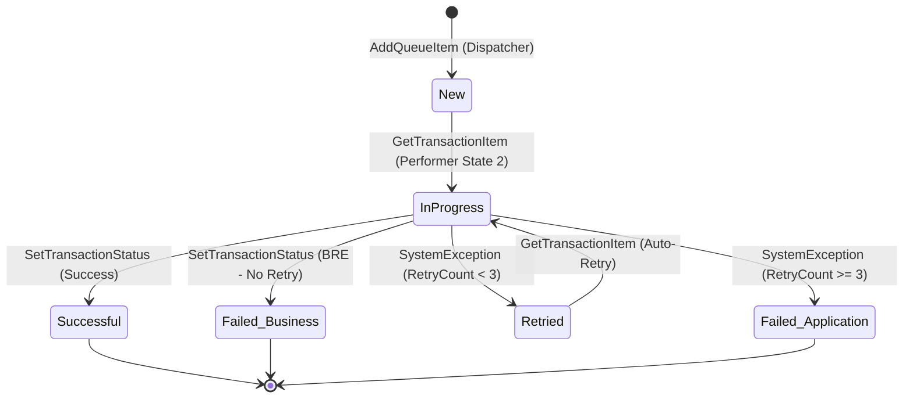
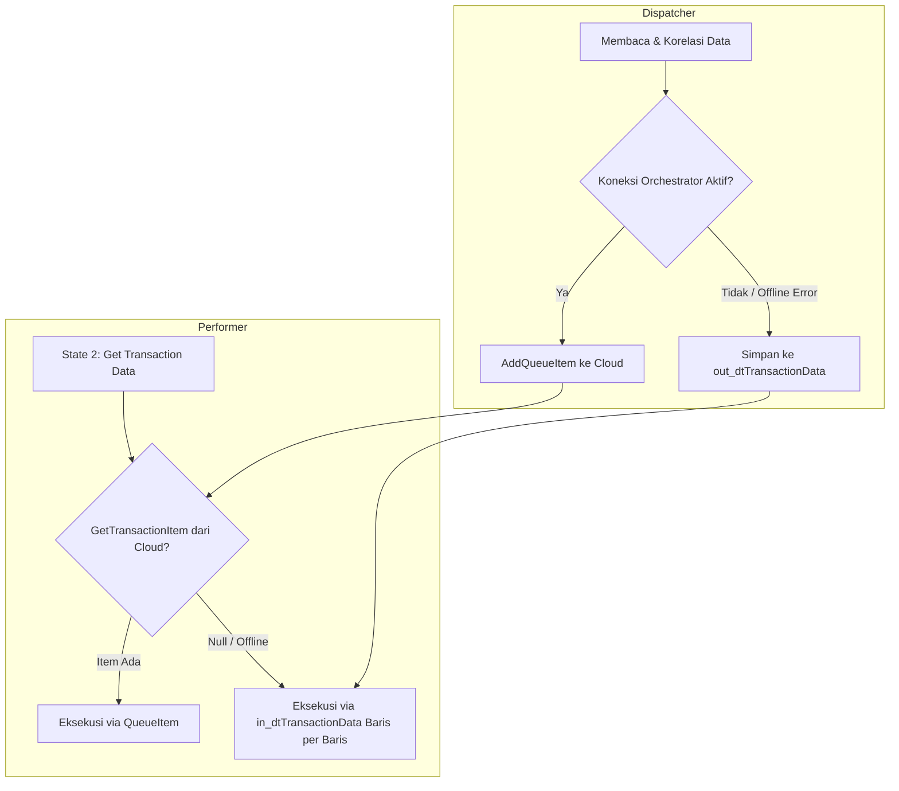

# Panduan Konfigurasi UiPath Orchestrator Cloud Queue
## Day 30 Banking Reconciliation Enterprise REFramework

Dokumen ini menjelaskan prosedur komprehensif integrasi proyek otomasi **Day30_BankingReconciliation** dengan **UiPath Automation Cloud Orchestrator**, siklus hidup transaksi (*Transaction Lifecycle*), skema data (*SpecificContent*), serta arsitektur ketahanan (*dual-mode offline fallback*).

---

## 1. Ikhtisar Integrasi Orchestrator (Overview)

Sesuai standar arsitektur Enterprise UiPath REFramework:
- **Dispatcher (`Dispatcher.xaml`)** bertugas mengekstrak transaksi dari berbagai sumber (*Core Banking* & *Switching Gateway*), memvalidasi integritas data, dan memasukkannya ke antrean terpusat di Orchestrator (*Queue Ingestion*).
- **Performer (`Performer_REFramework.xaml`)** bertugas mengambil item dari antrean secara transaksi demi transaksi (*Get Transaction Item*), mengeksekusi rekonsiliasi tiga arah, dan memperbarui status antrean (*Set Transaction Status*).

> [!IMPORTANT]
> **Kredensial & Autentikasi Pengguna**:
> Robot tidak membuat kredensial, tenant, folder, atau queue palsu. Koneksi ke UiPath Automation Cloud membutuhkan sesi autentikasi interaktif dari akun pengguna. Jika Anda menjalankan proyek ini di lingkungan lokal tanpa koneksi Orchestrator, sistem secara otomatis beralih ke mode **Local Fallback** tanpa error.

---

## 2. Langkah-Langkah Konfigurasi di Orchestrator Cloud

Ikuti langkah-langkah berikut untuk menghubungkan antrean cloud:

### Langkah 1: Autentikasi Robot via UiPath Assistant
1. Buka aplikasi **UiPath Assistant** di sistem operasi Windows Anda.
2. Klik ikon profil di pojok kanan atas, lalu pilih **Sign In**.
3. Browser akan terbuka mengarah ke portal **UiPath Automation Cloud** (`https://cloud.uipath.com`). Masukkan akun UiPath Anda.
4. Setelah berhasil masuk, status di UiPath Assistant akan berubah menjadi **Connected, Licensed** (ikon hijau).

*(Atau gunakan perintah CLI jika menggunakan token / client credentials: `uip login`)*.

---

### Langkah 2: Membuat Queue di Automation Cloud Orchestrator
1. Buka browser dan navigasikan ke portal **UiPath Automation Cloud**.
2. Masuk ke menu layanan **Orchestrator**.
3. Pilih Folder kerja yang digunakan robot (misalnya folder **Shared** atau **Default**).
4. Di panel navigasi sebelah kiri, pilih tab **Queues**.
5. Klik tombol **+ Add Queue** (atau tombol *Create a new Queue*).
6. Konfigurasikan form antrean dengan parameter berikut:

| Parameter | Nilai Konfigurasi | Penjelasan |
| :--- | :--- | :--- |
| **Name** | `BankingReconciliationQueue` | Harus sama persis dengan argumen `in_QueueName` di workflow |
| **Description** | `Antrean transaksi rekonsiliasi perbankan Day 30` | Deskripsi fungsional antrean |
| **Unique Reference** | `No` (atau `Yes` jika ingin mencegah duplikasi ID) | Jika aktif, mencegah ID Transaksi yang sama dimasukkan 2 kali |
| **Auto Retry** | **YES (Aktif)** | Mengizinkan Orchestrator melakukan retry otomatis jika terjadi kegagalan teknis |
| **Max # of retries** | **3** | Batas maksimal percobaan ulang untuk `SystemException` |

7. Klik tombol **Add** untuk menyimpan antrean baru.

---

## 3. Spesifikasi Skema Data Transaksi (`SpecificContent`)

Ketika Dispatcher memanggil aktivitas `ui:AddQueueItem`, setiap transaksi dipaketkan ke dalam kamus `Dictionary<string, object>` pada properti `ItemInformation` / `SpecificContent`:

| Nama Kunci (*Key*) | Tipe Data | Sumber Data | Contoh Nilai |
| :--- | :--- | :--- | :--- |
| `TransactionId` | `String` | Core Banking | `"TRX-2026-0001"` |
| `AccountNumber` | `String` | Core Banking | `"1001234567"` |
| `TransactionTime` | `String` | Core Banking | `"2026-11-15 08:30:15"` |
| `Channel` | `String` | Core Banking | `"ATM"` |
| `CoreAmount` | `Double` | Core Banking | `1500000.0` |
| `CoreStatus` | `String` | Core Banking | `"SUCCESS"` |
| `SwitchingAmount` | `Double` | Switching Gateway | `1500000.0` |
| `SwitchingStatus` | `String` | Switching Gateway | `"SUCCESS"` (atau `"NOT_FOUND"`) |

---

## 4. Siklus Hidup Transaksi (Transaction Lifecycle & Statuses)

Alur status item antrean di Orchestrator mengikuti standar siklus hidup REFramework:

### Penjelasan Status Antrean:
1. **`New`**:
   - Transaksi berhasil diunggah oleh Dispatcher dan siap diproses oleh robot pekerja.
2. **`InProgress`**:
   - Item sedang dikunci (*leased*) dan diproses oleh robot pekerja di `State 2 (Get Transaction Data)`.
3. **`Successful`**:
   - Transaksi memenuhi seluruh 3 validasi bisnis dan nominal cocok antara Core, Switching, dan Web Portal (17 transaksi *clean*).
4. **`Failed (Business Rule)`**:
   - Transaksi melanggar aturan bisnis (format rekening tidak valid, nominal <= 0, variance nominal/status, atau tidak ditemukan di Switching). Status langsung ditandai `Failed (Business)` **tanpa dilakukan percobaan ulang (*no retry*)**.
5. **`Retried`**:
   - Terjadi kegagalan teknis (seperti simulasi crash Chrome pada transaksi ke-7). Item antrean ditandai `Retried` dan dibuatkan item baru untuk diproses kembali di State 1 (Re-Initialization).
6. **`Failed (Application)`**:
   - Transaksi yang mengalami kegagalan teknis berulang kali hingga melampaui batas maksimal retry (3 kali).

---

## 5. Arsitektur Dual-Mode (Cloud Queue vs Local Fallback)

Untuk memastikan fleksibilitas operasional maksimal baik saat terkoneksi ke Orchestrator maupun saat berjalan secara offline pada mesin pengembang, proyek ini menerapkan arsitektur **Resilient Dual-Mode**:

### Keunggulan Desain:
- **Zero Configuration Breakdown**: Pengembang tidak perlu mengubah kode saat beralih antara pengujian mandiri (*standalone test*) dan eksekusi produksi melalui Orchestrator.
- **Enterprise Safe**: Semua pemanggilan Orchestrator dibungkus dalam blok `TryCatch` yang menangani potensi timeout atau otentikasi kedaluwarsa secara elegan.

